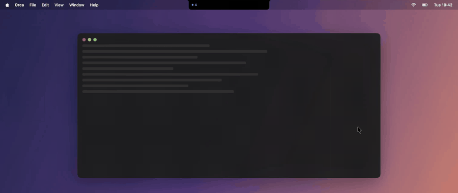

# Orca Notch

A macOS notch bar for [Orca](https://github.com/stablyai/orca). It watches every agent across
local Orca plus all paired environments (`orca environment list`), tells you when one needs you, and
pulls down a mini Orca: agent list, a card for each agent with one-click answers, and a reply box.

Recorded with mock agents via `--demo-record` (see [Demo](#demo)).

## Install

    ./scripts/build-app.sh      # builds, installs to ~/Applications, launches

Requires the Orca app running with the `orca` CLI installed (`/usr/local/bin/orca`).

## Using it

- **Collapsed:** the notch grows ears when agents exist. Left = working count (blue), right = badge
  for agents that need you (orange = permission, yellow = waiting on you, green = finished, unseen).
- **New alert:** the notch peeks down for 5s with the agent + what it wants, and plays a sound.
- **Open:** hover the notch (closes when you leave), click it or press **⌥⌘O** (stays open; Esc or
  click outside to close).
- **Pull-down:** pick an agent → a card with your last prompt, its last reply (markdown), and when it is blocked/asking, the menu from its screen as buttons (fallback Approve / Always / Deny). Reply box sends text + Enter. The terminal toggle shows the styled raw screen with quick keys. "Orca" focuses that terminal in Orca.
- Gear menu: sound, launch at login, clear finished, rescan environments, quit.

## How it works

Polls the `orca` CLI every 2s (~0.1s per call locally, ~0.5s per remote):
`worktree ps --json` for agent state (`working | blocked | waiting | done`), `terminal list` to map an
agent's `paneKey` (`tabId:leafId`) to a terminal handle, `terminal read --screen` / `terminal send`
for the pull-down. The screen is plain text, so `TerminalStyler` recolours it from agent TUI shapes.

Dev flags: `.build/debug/OrcaNotch --expanded` or `--peek-demo`.

## Demo

    swift build
    .build/debug/OrcaNotch --demo                     # scripted demo with mock agents on a fake desktop
    .build/debug/OrcaNotch --demo-record demo/out.mp4 # same, recording only the demo window (ScreenCaptureKit)

The demo never calls the orca CLI; everything comes from `Sources/OrcaNotch/Demo.swift`.
